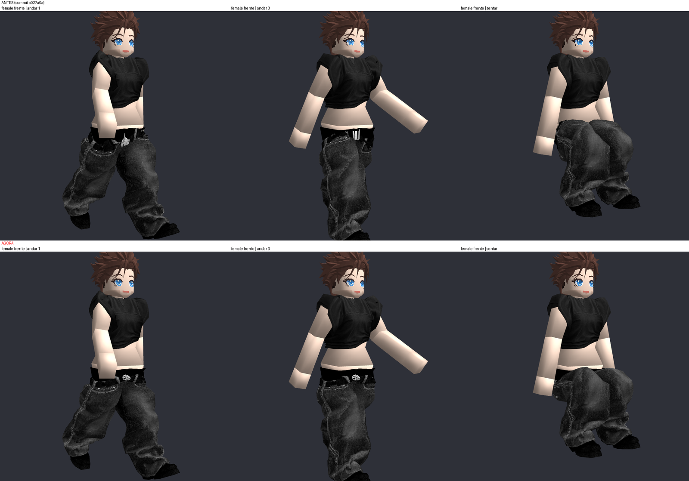
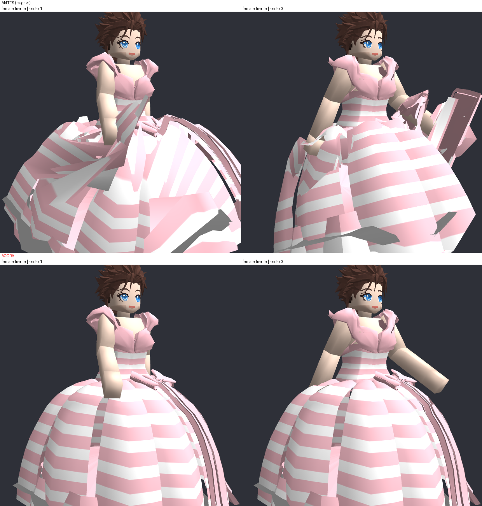
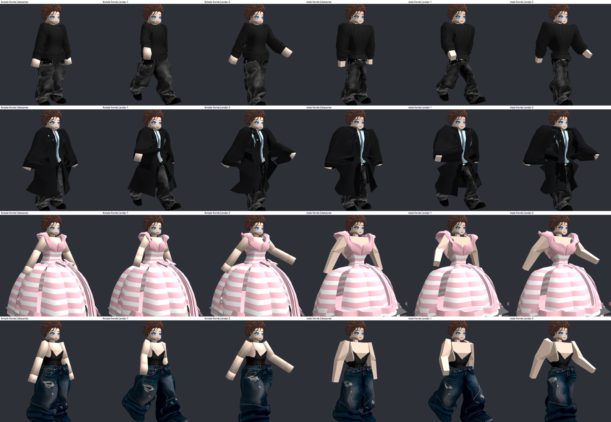
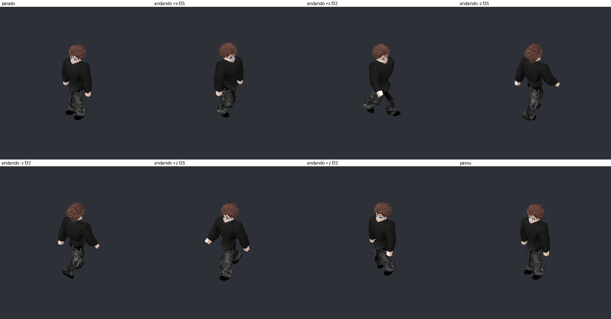
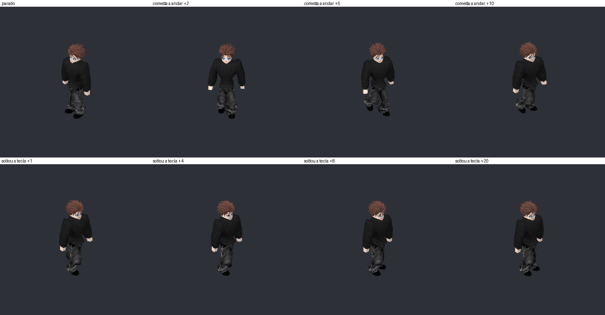

# 🦴 Animação, Esqueleto e Pesos das Roupas

## 📌 Resumo

O personagem é vestido em A-pose (a pose das cages) e mostrado no jogo na **pose de descanso**, de onde anda.
Corpo, cabelo e roupas são deformados pelo mesmo esqueleto de 16 ossos com *linear blend skinning* em numpy
(`src/clothing/skeleton.py` e `src/clothing/character_animation.py`). Os pesos das roupas não vêm de pintura
manual: são calculados a partir da cage em que cada vértice foi encaixado e da própria malha da roupa.

---

## 🦴 Esqueleto do jogo

- Um rig por corpo: `assets/models/rig_female.json` e `rig_male.json`, exportados do Blender
  (`Rig_Jogo_Feminino` em `123.blend`, `Rig_Jogo_Masculino` em `male_cage_work.blend`) por `scripts/export_rig.py`
  e montados por `scripts/build_game_rig.py`.
- Ossos: `Pelvis`, `Torso`, `Neck`, `Head`, e por lado `UpperArm`, `LowerArm`, `Hand`, `UpperLeg`, `LowerLeg`, `Foot`.
- `Skeleton.pose(rotações, raiz)` devolve as matrizes; `skin(rows, indices, weights, matrizes)` deforma posição e normal.
- A caminhada usa `walk_pose` do token do mundo (`token_system.py`), então mundo e visualizador andam igual.

## 🧍 Pele

- Cada parte de pele recebe o osso da sua região (braço, antebraço, mão, pescoço) ou o mais próximo da cage
  dentro da sua região anatômica (tronco só pelve/torso; pernas só ossos de perna).
- **Ombro rígido:** braço e manga giram como um bloco, o tronco não é puxado pelo braço (escolha do usuário).
- Pescoço dobra só do lado da cabeça; as outras juntas misturam ±3,5 cm em volta da articulação.
- **Joelho e cotovelo** misturam numa faixa tão larga quanto a distância do vértice ao osso: tecido largo
  (calça larga) dobra num arco maior e não estica na dobra.
- Um vértice da pelve entre as duas coxas mistura só com a coxa mais próxima.
- A animação **nunca remove pele**; o que fica escondido é decidido só pelo HSR (ver [[Sistema de Roupas|Sistema-de-Roupas]]).

## 👕 Pesos das roupas (`CharacterAnimator._cloth_weights`)

1. **Rótulo do encaixe:** a parte da cage em que cada vértice foi encaixado (`*_parts.npy`), reconciliada com o
   ancestral mais próximo.
2. **Limpeza de rótulos impossíveis** (`_clean_labels`), por peça conexa da roupa:
   - peça pequena (≤ 30 vértices: elo, botão) é rígida, com o osso que a maioria tem;
   - peça só de membros (luva, polaina) quase toda de um lado fica toda nesse lado;
   - peça com ≥ 60% dos vértices num membro (manga costurada à parte de um casaco) é toda desse membro;
   - numa peça que chega ao tronco, tecido de um osso precisa encostar em tecido do osso pai, descendo do tronco
     (manga = mão, antebraço, braço, tronco); o resto recebe o osso do tecido em volta.
3. **Só confia no rótulo onde o tecido envolve o membro** (`_wrapping`): manga, perna de calça. Tecido que só
   fica perto (lateral de um casaco ao lado da mão) passa para a parte do corpo ao lado, nunca antebraço ou mão.
   O rótulo de braço é mantido (manga curta cobre o ombro sem dar a volta). Peças só de membros mantêm o rótulo.
4. **Mistura harmônica sobre a malha da roupa** em ombros e quadris: o rótulo vale onde é certo (bem dentro do
   membro, longe da emenda com o outro membro); no resto, a parte de cada membro é interpolada pela malha.
   Entre as pernas (gancho da calça, meio da saia) o tecido é dividido entre elas. Até 4 ossos por vértice.
5. **Tecido longe do membro fica com o tronco:** quem não envolve o membro é carregado por inteiro até 20 cm do
   osso e por nada a partir de 40 cm (barra de vestido de baile, capa).

*Cós e assento da calça inteiros ao andar e sentar (antes, em cima; depois, embaixo).*

*Vestido longo: antes se despedaçava ao andar; agora sai inteiro.*

## 💪 Pose de descanso dos braços

- O ângulo de descanso é o menor em que antebraço e mão não tocam o quadril do corpo **nem a roupa que o braço
  não carrega**, contando a largura da manga que o braço veste. Limite: **30°**.
- O limite veio de um estudo do catálogo (`scripts/study_rest_arm_angle.py`): toda roupa comum, inclusive as
  calças mais largas e casacos, é liberada até 29°; acima disso só vestidos de baile e fantasias de corpo inteiro.
  Cada centímetro de largura a mais pede em média meio grau a mais (baggy jeans: 21° no feminino, 17° no masculino).

## 🚶 Caminhada no mundo

- O token do mundo (`PlayerToken`) usa o mesmo `CharacterModel` vestido e um `CharacterAnimator`; o passo
  segue a velocidade do token. `--token-antigo` volta ao boneco modular antigo.
- Começar e parar de andar têm transição suave (~0,2 s): cada articulação gira só parte do caminho
  (`partial_rotation`).
- Custo: ~8 ms por quadro andando (CPU, numpy); parado, zero. Mais de um personagem na tela pediria skinning na GPU.

