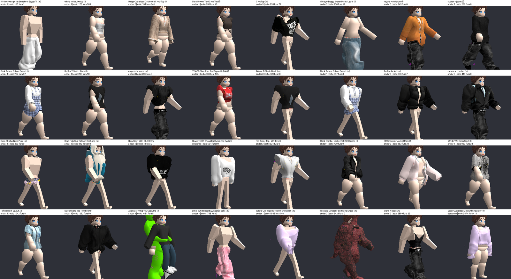
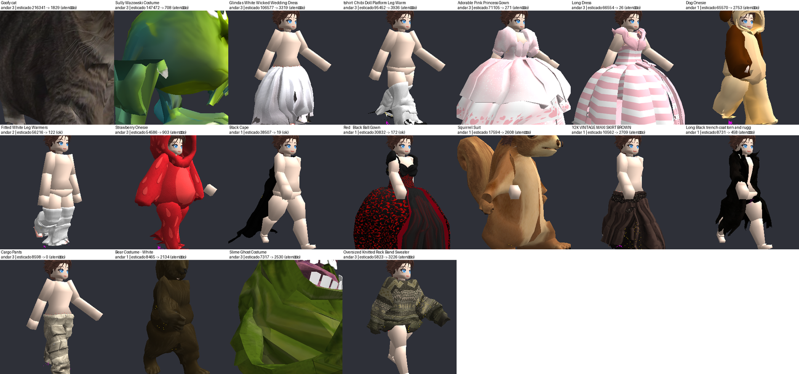

# 🧪 Bateria de Robustez das Roupas

## 📌 Resumo

`scripts/audit_animation_robustness.py` veste cada roupa baixada em `assets/models/clothing` (sozinha, e alguns
conjuntos), nos dois corpos, passa por várias poses e mede três defeitos sem olhar imagens. O veredito
(ok / atenção / falha) vale para as poses que o jogo usa; as demais aparecem à parte.

## ▶️ Como rodar

```
python scripts/audit_animation_robustness.py --bodies female --output artifacts/robustness/female
python scripts/audit_animation_robustness.py --bodies male   --output artifacts/robustness/male
python scripts/audit_animation_robustness.py --output artifacts/robustness --report artifacts/robustness/female artifacts/robustness/male
```

- `--only <id> ...` mede só algumas peças (minutos, útil para validar uma mudança).
- Rode um corpo por vez: as duas rodadas juntas já esgotaram a memória da máquina.
- Quando a versão do cache das roupas muda (`Universal Fitted Clothing vNN`), a primeira rodada reencaixa o
  catálogo inteiro (perto de 1 h); depois, ~10 min por corpo.
- Saída: `medidas.json` (cru), `relatorio.json`, `relatorio.md`, `falhas.png` e `atencao.png` com miniaturas
  marcadas (amarelo = esticado, vermelho = pele furando, magenta = buraco).

## 📏 Medidas e limites

| Medida | O que é | Atenção | Falha |
|---|---|---|---|
| Esticado | área (cm²) de triângulos da peça testada com aresta > 2,5× e > 2 cm maior que no encaixe | 600 | 4000 |
| Pele furando | área de pele desenhada com tecido logo abaixo (até 4 cm) e nada por cima (7,5 cm), menos o que já fura na pose de vestir | 100 | 400 |
| Buraco | pele escondida pelo HSR que se vê de fora (≥ 30% das direções livres), na pose de vestir | 100 | 500 |

- Poses do jogo: descanso e quatro fases da caminhada. Extras: braços a 90°, braços à frente, sentar.
- Os limites foram fixados olhando as miniaturas do catálogo inteiro: até 600 cm² de esticado nada aparece na
  distância do jogo (um suéter estica ~400 sob o braço); acima de 4000 a peça está visivelmente rasgada.
- **Esticado** é a medida confiável. **Pele furando** e **buraco** não foram validadas por imagem: várias falhas
  só por elas não mostram defeito claro na miniatura.



## 📊 Última rodada completa (06/10/2026, cache v34)

204 combinações (102 por corpo): **101 ok, 70 atenção, 33 falha**. Falhas por tecido rasgado: Baby Shark, Sully,
Realistic White Pigeon, Squirrel Suit, Strawberry Onesie, White Cat Costume e Cloak (fantasias e capa). As outras
falhas são só por buraco ou pele furando. Desde então foram corrigidos os Oversized Warmers (pele furando 465 → 0)
e as luvas sem dedos e adesivos de corpo.

Evolução: 79 ok / 52 / 73 falha → depois dos pesos gerais das roupas 91 / 74 / 39 → 101 / 70 / 33.



## ⚠️ Pendências conhecidas

- Fantasias de corpo inteiro e Cloak acima do limite de esticado.
- Calça de moletom com tênis embutido em atenção (~630 cm²).
- Baggy jeans com o cós ~9 cm longe do corpo e sobretudo com ponta no quadril: vêm do modelo da peça e da
  proporção do nosso corpo (mais estreito que o Blocky); mudar exigiria mexer no encaixe de todas as roupas largas.
