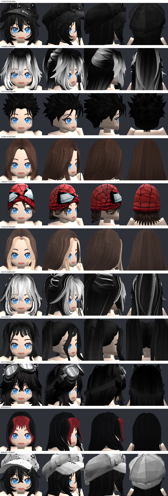
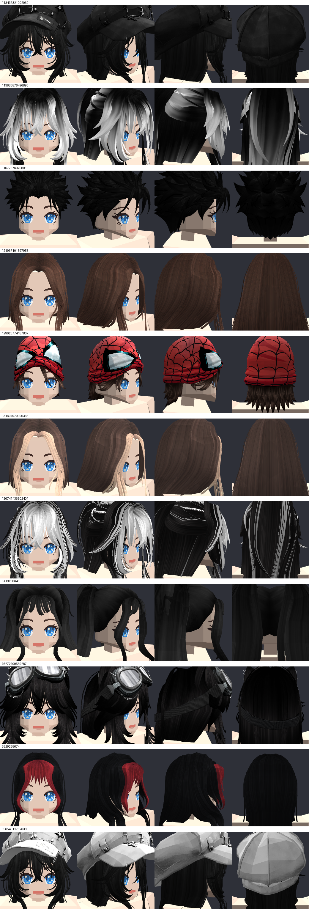

# 💇 Cabelos e Acessórios de Cabeça

## 📌 Resumo

Além de vestimentas deformáveis de corpo inteiro, o Isometricon implementa um pipeline especializado para **cabelos e acessórios de cabeça** (bonés, chapéus, óculos e tiaras). O posicionamento é governado pela hierarquia de **attachments** R15 do Roblox (`HatAttachment`, `HairAttachment`, `FaceCenterAttachment`), enquanto o ajuste fino contra o crânio estilizado do nosso personagem é realizado pela cage da cabeça (`src/clothing/hair_fit.py`).

---

## 📌 Sistema de Attachments e Conformação

O fluxo de importação e posicionamento é descrito a seguir:

1. **Leitura do `.rbxm`:** O arquivo binário é decodificado por `src/clothing/rbxm.py`, localizando a malha (`HandleMesh`) e a instância `Attachment` correspondente.
2. **Transformação de Referência:** A posição e rotação relativas do attachment em relação à cabeça padrão R15 são computadas como uma matriz afim ($T_{\text{ref}}$).
3. **Reancoragem:** A matriz é transferida para o attachment equivalente da cabeça do nosso avatar.
4. **Ajuste pela Cage da Cabeça:** Vértices do cabelo próximos à superfície do crânio são adaptados pela cage para evitar que a calota craniana fure as mechas ou que chapéus fiquem flutuando.

---

## 🧑‍🦰 Suporte Multi-Corpo (Feminino e Masculino)

A conformação de cabelos e chapéus é executada de forma independente por corpo, gerando caches específicos:
- `Hair_fitted_<id>_female.obj`
- `Hair_fitted_<id>_male.obj`

### Cabelo Padrão Feito à Mão
O modelo `Hair_fitted_116773763268018.obj` representa o cabelo base do jogo, modelado e ajustado manualmente com tratamento poligonal exclusivo, sendo preservado de qualquer exclusão automática.

---

## 🖼️ Galeria de Estilos e Chapéus

Abaixo estão os 11 estilos testados em 4 visualizações (frente, 3/4, perfil lateral e costas):

### 1. Cabeça Feminina

*Figura 1: Da esquerda para a direita: boné punk Y2K, mechas bicolores, cabelo espetado anime, liso clássico, gorro de aranha, popstar loiro/castanho, meio-preso anime, maria-chiquinha dupla, óculos steampunk e boina estilizada.*

### 2. Cabeça Masculina

*Figura 2: Os mesmos 11 estilos adaptados à proporção da cabeça do modelo masculino.*
