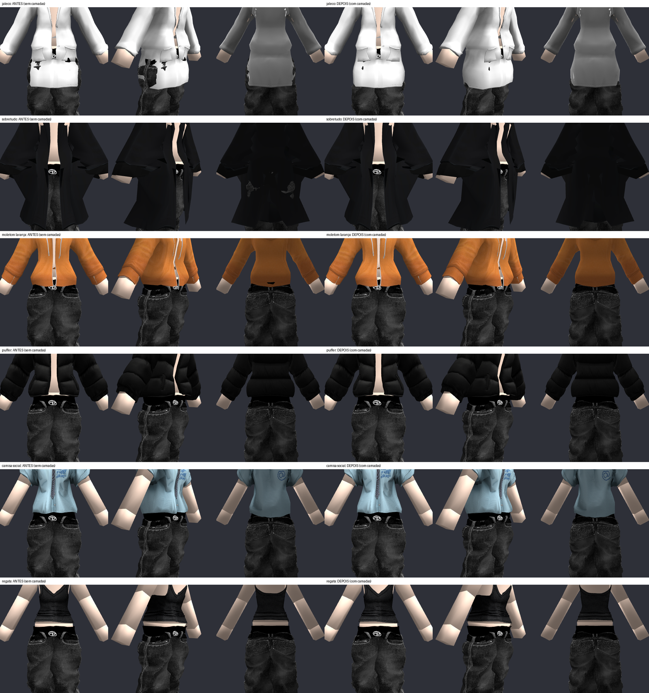
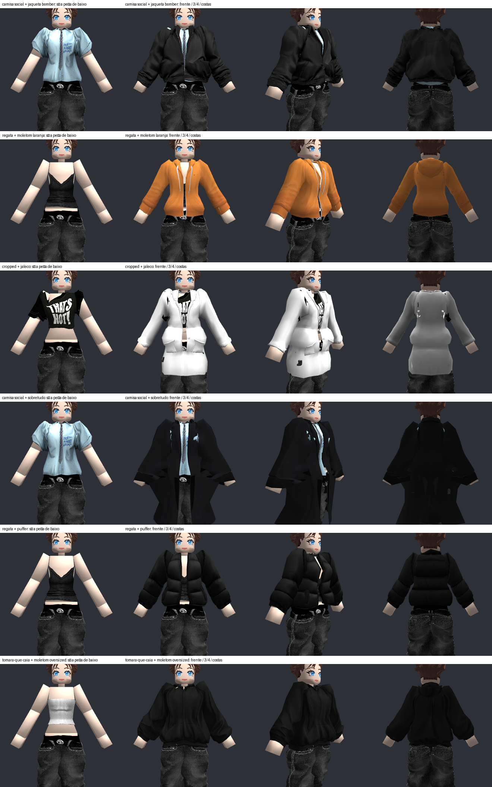
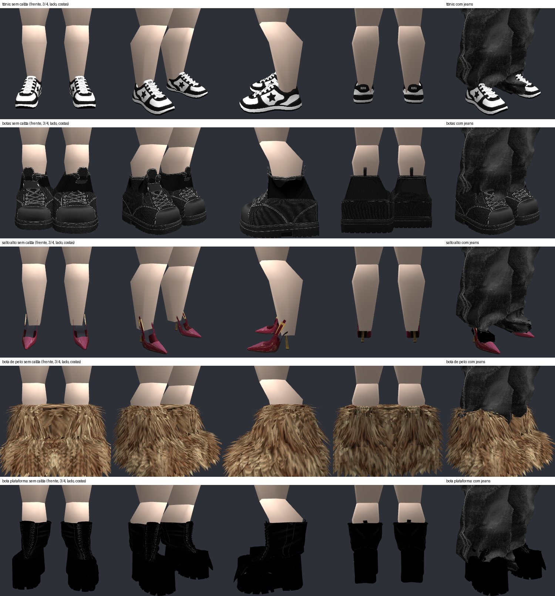

# 🧥 Camadas de Roupas e Sapatos

## 📌 Resumo

Um dos maiores desafios em motores de customização 3D é vestir peças sobrepostas (por exemplo, jaqueta bomber sobre camisa polo, ou moletom com capuz por cima de camiseta e calça jeans) sem que a camada inferior fure o tecido da camada superior. O Isometricon soluciona isso encadeando dinamicamente as **Outer Cages**: a peça de cima usa a outer cage deformada da peça de baixo como sua referência de inner cage. Além disso, introduz suporte a calçados com sola rígida e cano adaptativo ajustado pela cage do tornozelo.

---

## 🔄 Encadeamento de Camadas (Layer Clearance)

O sistema de camadas é gerenciado em `src/clothing/layer_clearance.py` e integrado ao `src/clothing/character_model.py`.

### Regras de Encaixe por Camada
1. **Peça Interna:** Veste a cage original do corpo.
2. **Peça Intermediária:** Veste a outer cage inflada da peça interna com uma folga mínima (offset de $2\text{ mm}$ a $5\text{ mm}$).
3. **Casacos e Sobretudos:** Detectam simultaneamente a presença de tops e calças, conformando a cintura e os braços sobre a outer cage combinada de ambas as peças.

*Figura 1: Resolução de colisões entre jaqueta, moletom, jaleco, sobretudo e calça. À esquerda sem encadeamento (clipping); à direita com o sistema de camadas.*

---

## 💬 Comandos Interativos no Chat

O jogo disponibiliza comandos de depuração e ajuste em tempo real via chat console (`src/interactive/chat_console.py`):

### 1. `/jaqueta [folga] [puxar]`
Ajusta interativamente a folga entre camadas e a força de atração sobre a peça interna.
- `/jaqueta 5`: Aplica $5\text{ mm}$ de folga extra em volta da camisa.
- `/jaqueta folga=3 puxar=0.8`: Modifica a aderência nas bordas.

### 2. Visualização de Camadas Complexas

*Figura 2: Camisa social com gravata sob sobretudo longo e jaqueta bomber, mantendo o colarinho visível sem deformações indesejadas.*

---

## 👟 Sistema de Sapatos e Calçados

Calçados exigem um tratamento misto único:
- **Solado e Pé:** Geometria rígida que não deve dobrar nem colapsar com a cage.
- **Cano do Sapato (Bota / Tênis de Cano Alto):** Deforma suavemente acompanhando a outer cage da calça ou da canela do corpo.

O comando `/sapato [id]` veste calçados garantindo que a barra da calça se acomode dentro ou fora do cano da bota conforme a categoria do calçado.

*Figura 3: Tênis esportivo, coturno plataforma, salto alto fino e bota felpuda de inverno demonstrados sozinhos e em conjunto com calça jeans.*

## 👟 O corpo sobe para ficar sobre a sola

A origem do corpo fica 2,5 cm acima da planta do pé, e a sola de um calçado desce mais ainda (tênis 6 a 7 cm, botas
7,5 a 9 cm abaixo da origem): com o corpo apoiado pela origem, os pés afundavam um pouco no chão e os tênis quase
somem dentro dele.

- O animador mede, na pose de vestir, o ponto mais baixo do que o corpo pisa (`CharacterAnimator._standing_height`):
  o dos calçados quando há (`shoe_*`), o da pele dos pés quando não. O corpo sobe isso (`_sole`, somado ao ajuste que
  já existia para pernas mais compridas), no máximo `SOLE_LIMIT` (20 cm).
- É recalculado a cada vez que o personagem é montado: trocar de calçado, ou tirá-lo, muda a altura sozinho.
- **Só calçados.** A barra de uma calça larga ou de um vestido encosta no chão e não deve levantar o corpo.
- **Limite conhecido:** botas que fazem parte da calça (o "Black Distressed Designer Jeans w/ Boots") não são
  calçado para o jogo e continuam 5,5 cm dentro do chão; não há como distingui-las da barra de uma calça larga.

