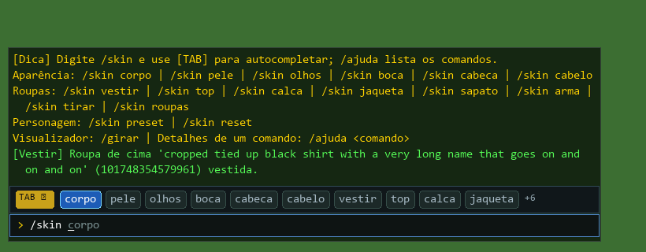
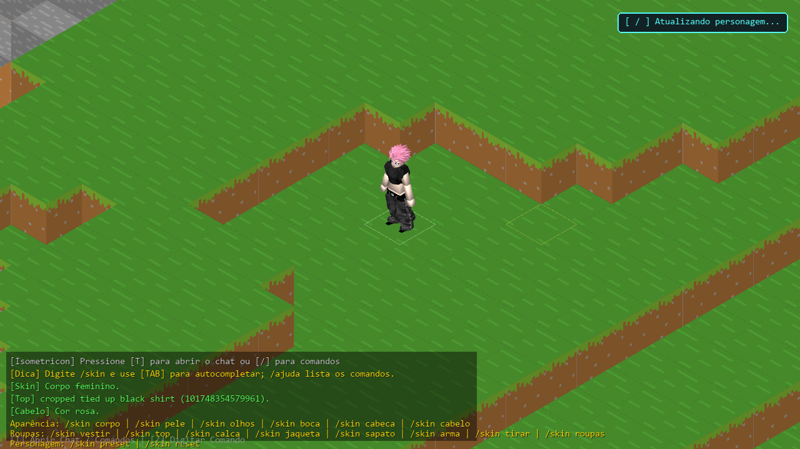

# 💬 Comandos do Chat

Abra o chat com **[T]** ou **[/]**; **[TAB]** completa e cicla as opções. Tudo que muda o personagem fica sob
`/skin`. Os comandos são definidos num quadro único em `src/interactive/skin_commands.py`, de onde saem a
execução, o autocompletar e a ajuda.

| Comando | O que faz |
|---|---|
| `/skin corpo <feminino\|masculino>` | troca o corpo |
| `/skin pele <palida\|clara\|bronzeada\|morena\|negra>` | tom de pele |
| `/skin olhos <cor\|estilo>` | azul, verde, castanho, roxo, vermelho, dourado, ciano; anime, piscando, classico, sem |
| `/skin boca <estilo>` | anime, sorriso, aberta, piscando, neutra, classica, gato, beicinho, sem |
| `/skin cabeca <arredondada\|quadrada>` | formato da cabeça |
| `/skin cabelo <id\|cor\|careca\|raspado\|padrao>` | troca ou pinta o cabelo |
| `/skin cabelo posicao <x\|y\|z> <cm>` · `escala [x\|y\|z] <fator>` · `reset` | ajusta o cabelo (como acessório no Roblox) |
| `/skin vestir <id\|link\|nome> [tipo] [refazer]` | veste qualquer item do Roblox no lugar certo, pelo tipo do asset |
| `/skin top <nome\|id\|none>` · `/skin calca ...` | roupa de cima e de baixo |
| `/skin jaqueta <id\|none>` · `folga <mm>` · `puxar <mm>` | peça por cima do top e suas camadas |
| `/skin sapato <pacote\|esquerdo,direito\|none>` | calçado |
| `/skin arma <katana\|id\|none>` | item na mão |
| `/skin tirar <top\|calca\|jaqueta\|sapato\|cabelo\|arma\|tudo>` | remove (tudo mantém o cabelo) |
| `/skin roupas` | lista o que está vestido |
| `/skin preset <padrao\|gato_loiro\|cavaleiro\|rosa\|classico>` · `/skin reset` | aparência pronta (mantém o corpo) |
| `/skin olhos <formato>` | formato dos olhos: padrao, arredondado, grande, feminino, fechado, sonolento, estreito, puxado, caido, suave, suave_redondo; outros modelos: serio, masculino, afiado, redondo, retro, cansado, felino |
| `/skin olho <direito\|esquerdo> <cor>` | cor de um olho só (`/skin olhos <cor>` volta os dois à mesma) |
| `/skin maquiagem <batom\|sombra> <cor\|sem>` · `contorno <suave\|marcado\|sem>` · `<blush\|sardas> <sim\|nao>` · `sem` | maquiagem (as sombras do queixo ficam em `/skin ajuste rosto_sombra`); cores: vermelho, rosa, nude, vinho, roxo, azul, verde, dourado, marrom, preto |
| `/skin hsr espelhar <sim\|nao>` · `<esconder\|mostrar\|apagar> <pontos>` · `limpar` | a pele escondida sob a roupa: espelhar os dois lados do corpo, ou corrigir à mão os pontos da cage (o pincel da seção Ajuste fino) |
| `/skin extra <nome\|id\|none>` | veste ou tira uma peça a mais, junto com as outras |
| `/skin sobrancelha <padrao\|grossa\|decidida\|sem>` | estilo das sobrancelhas |
| `/skin nariz <sim\|nao\|formato\|sombra legado\|sombra calculada>` | nariz 3D e seu formato: padrao, projetado, ponta_larga, narinas_largas, aquilino, arrebitado, fino, largo, botao, longo, botao_largo, botao_arrebitado, narinas_grandes, achatado, batata, aberto, bloco, bloco_narinas; a sombra é a legada (um trecho fixo) ou a calculada pelo contorno do nariz (ajustes em `/skin ajuste`: `nariz_tamanho`, `nariz_altura`, `nariz_projecao`, `nariz_largura`, `nariz_ponte_largura`, `nariz_ponte_altura`, `nariz_ponta_largura`, `nariz_ponta_projecao`, `nariz_base_largura`, `nariz_base_altura`, `nariz_narinas_altura`, `nariz_ponta_cor`, `nariz_sombra`; pele: `vitiligo`, `vitiligo_forma`) |
| `/skin ajuste <nome> <-100 a 100>` · `reset` | proporções: altura, cabeca, pescoco, ombros, peito, cintura, pelve, quadril, bunda, bracos, bracos_comprimento, maos, pernas, pernas_comprimento, pes, folga, olhos_tamanho, olhos_altura, olhos_distancia, sobrancelha_tamanho, sobrancelha_altura, sobrancelha_distancia |
| `/skin salvar` · `/skin carregar` | grava o personagem em `saves/personagem.json`, ou volta ao gravado |
| `/skin interface` | abre a [[tela de criação de personagem\|Criacao-de-Personagem]] |
| `/ajuda [comando]` | lista por grupo, ou uso e apelidos de um comando |
| `/girar [on\|off]` | rotação automática (só no visualizador `--char`) |

Cada comando aceita também um apelido em inglês (`/skin eyes`, `/skin wear`, `/skin pants`...).

**Removidos em 06/10/2026:** os ajustes que deformavam corpo ou roupa depois do encaixe pela cage (manga, braço,
quadril, cintura, barra, postura) — mexiam só no corpo ou só na roupa e quebravam o encaixe, o HSR e a
animação; e os atalhos soltos no primeiro nível (`/top`, `/eyes`, `/import`, `/x`, `/fora`...).

