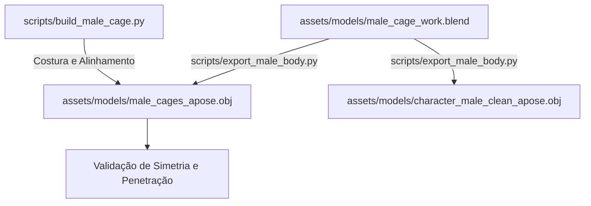
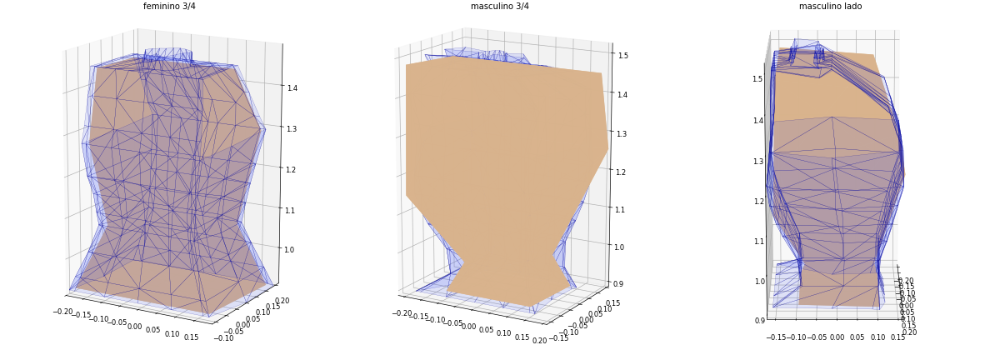
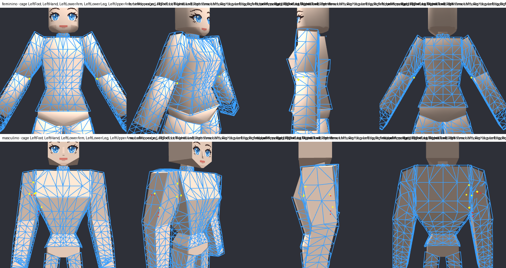
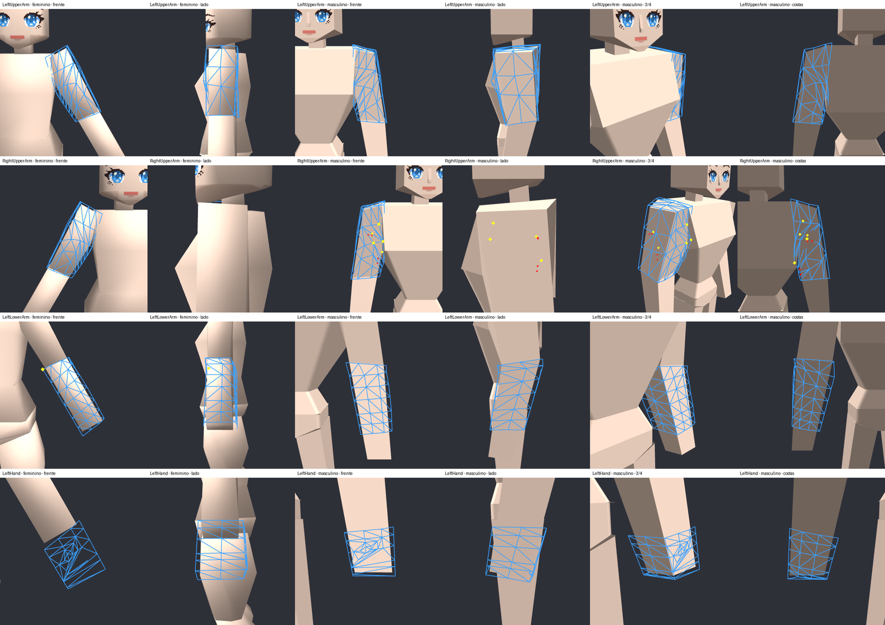
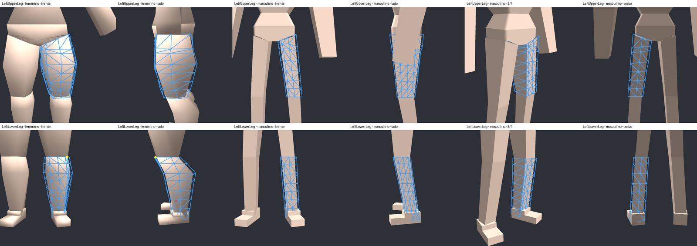
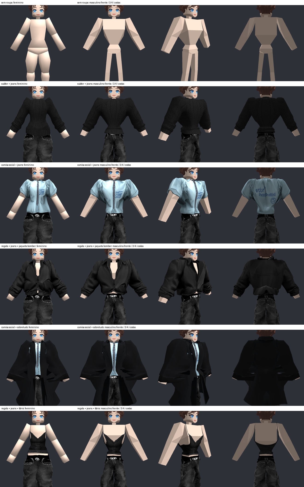

# 🧑 Corpo Masculino e Compartilhamento de Cages

## 📌 Resumo

Para suportar avatares masculinos e femininos com **100% de paridade**, o Isometricon adota o princípio de **topologia isomórfica de cage**: a cage masculina possui exatamente o mesmo número de vértices, faces e parametrização UV da cage feminina (`assets/models/female_cages_apose_stage2.obj` e `assets/models/male_cages_apose.obj`). Isso permite que todo o catálogo de roupas do Roblox funcione em ambos os sexos sem necessidade de duplicar malhas ou criar regras específicas por gênero no código de deformação.

---

## 🛠️ Modelagem no Blender e Pipeline de Construção

A geometria masculina foi modelada e refinada no arquivo `assets/models/male_cage_work.blend` e é exportada automaticamente pelo script `scripts/export_male_body.py`.



### Etapas da Construção da Cage Masculina
1. **Tórax Trilinear:** O tórax masculino foi projetado sobre a silhueta em cunha masculina através de interpolação caixa-a-caixa, garantindo que os ombros largos não gerassem dentes no colarinho.
2. **Pelve Anel por Anel:** A pelve foi mapeada eixo a eixo para eliminar qualquer torção na virilha e costurada ao tórax.
3. **Pernas e Joelhos:** As pernas da cage R15 original foram ajustadas com topo inclinado e correção no joelho para evitar pontas salientes na flexão.
4. **Braços e Mãos:** Antebraços e mãos alinhados estritamente na A-pose padronizada.


*Figura 1: Mapeamento volumétrico da cage do tórax feminino para o formato masculino.*

---

## 📏 Medições de Folga e Colisão (Relatório de Auditoria)

Conforme registrado em `artifacts/male_cage/relatorio.json`, a cage masculina foi auditada membro por membro para assegurar ausência total de penetração na pele:

| Parte do Corpo | Vértices | Distância Mediana da Pele (cm) | Distância Máxima (cm) | Pontos da Cage dentro da Pele | Amostras Cobertas |
| :--- | :---: | :---: | :---: | :---: | :---: |
| **UpperTorso** | 231 | 1.06 cm | 4.24 cm | **0** | 550 / 550 (100%) |
| **LowerTorso** | 105 | 1.15 cm | 3.10 cm | **0** | 420 / 420 (100%) |
| **LeftUpperLeg** | 80 | 1.23 cm | 1.72 cm | **0** | 167 / 167 (100%) |
| **RightUpperLeg** | 80 | 1.23 cm | 1.72 cm | **0** | 160 / 160 (100%) |
| **LeftUpperArm** | 72 | 1.18 cm | 2.10 cm | **0** | 180 / 180 (100%) |
| **RightUpperArm**| 72 | 1.18 cm | 2.10 cm | **0** | 180 / 180 (100%) |

> **Resultado:** **Zero pontos da cage penetrando a malha do corpo** em todas as regiões anatômicas avaliadas.

---

## 🔍 Inspeção Visual de Simetria e Malhas


*Figura 2: Cage feminina (topo) e cage masculina (base) sobrepostas diretamente aos seus respectivos corpos poligonais.*

````carousel

<!-- slide -->

````

---

## 👔 Resultado: O Mesmo Catálogo no Corpo Masculino

Graças à uniformidade da cage, as mesmas roupas vestem o homem e a mulher:


*Figura 3: Roupas de manga longa, regatas, camisas sociais, jaquetas e sobretudos vestindo o avatar masculino com total estabilidade geométrica.*
