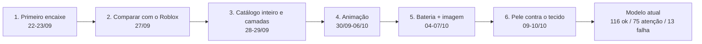

# 🗺️ Mapa de Testes e Ajustes: do primeiro encaixe ao modelo atual

## 📌 Resumo

Esta página segue o caminho do sistema de roupas de **22/09 a 10/10/2026**: o que se viu de errado, **qual teste ou
medida mostrou**, o que foi ajustado e como ficou. Os testes foram avaliados com ajuda do Claude, e as decisões foram do autor (ver
[[Testes e Verificações com o Claude|Testes-e-Verificacoes-com-o-Claude]]); cada linha leva ao detalhe em outra página.

Os números da bateria (ok / atenção / falha em 204 combinações roupa × corpo) mostram a evolução:

| Marco | ok | atenção | falha |
| :--- | :---: | :---: | :---: |
| Primeira medição da bateria | 79 | 52 | 73 |
| Pesos gerais das roupas | 91 | 74 | 39 |
| Mais ajustes de peso | 101 | 70 | 33 |
| Regra nova de buraco (3 cm) | 117 | 70 | 17 |
| Manga × capa e balanço dos braços (07/10) | 117 | 74 | 13 |
| Pele contra o tecido (09/10, **modelo atual**) | 116 | 75 | 13 |

> Na última linha o número de "ok" cai 1 por causa da forma de medir (a diferença para a pose de vestir), não de um
> defeito novo: o total de pele furando caiu 16% e **nenhuma peça piorou**.

---

## 🧭 Visão geral

---

## 1️⃣ Primeiro encaixe (22 a 23/09)

| O que estava errado | Como foi visto | Ajuste | Resultado |
| :--- | :--- | :--- | :--- |
| Cortar braços e encolher o corpo sob a roupa criava buracos em roupas novas, decotes e regatas. | Teste visual com roupas variadas. | **Descartado**; motor universal com cages (`7e0f211`). | Base do sistema. |
| Interpolação trilinear em caixas: a roupa colapsava em cotovelos e joelhos. | Teste nas dobras das juntas. | **Descartada**; cages por parte do R15 com blend hermite (`884bd1b`). | Encaixe por parte. |
| Ombro, decote e manga. | Testes de ancoragem de ombro, preservação de decote e filtro de mangas (`4fa9449`). | Ancoragem anatômica do ombro. | Passaram. |

## 2️⃣ Comparar com o Roblox Studio (27/09)

| O que estava errado | Como foi visto | Ajuste | Resultado |
| :--- | :--- | :--- | :--- |
| Projeção só radial esticava barras de vestidos e calças skater. | **Ground truth**: erro ponto a ponto contra a exportação do Roblox ([[Validação com Roblox|Validacao-com-Roblox]]). | Radial + prisma (`559dc38`). | Percentil de erro caiu mais de 50%. |
| Pele aparecendo por baixo das roupas. | Comparação com o HSR do Roblox. | HSR do Roblox (`319f7bd`). | Pele escondida. |
| Roupas sem HSR 0x12 (formatos v2/v3) mostravam pele demais. | Teste com 35 roupas novas do catálogo (`2a6a04b`). | Máscara geométrica por raio + margem (`c00195b`, `4e28365`). | Roupas sem HSR passam a vestir. |
| Texto e bolsos invertidos (camisetas "76ers", "Brooklyn"). | Inspeção visual. | Sem espelhamento em X (`7afe2e2`). | Corrigido. |
| Fantasias de corpo inteiro com buraco no zíper; cós da calça atravessando o moletom. | Inspeção visual (`eb16c4e`, `d0b38de`). | HSR por raio; cós ajustado. | Corrigidos. |

## 3️⃣ Catálogo inteiro e camadas (28 a 29/09)

| O que estava errado | Como foi visto | Ajuste | Resultado |
| :--- | :--- | :--- | :--- |
| 7 peças não vestiam. | Rodar o catálogo inteiro. | Pareamento de cages generalista (`af4b9cd`). | As 7 vestem. |
| Pés sumiam com calças até o tornozelo; barras de saia rasgavam entre as pernas. | Inspeção por imagem. | Preservar o pé (`89a4e2b`); vértices livres a mais de 3 cm da cage (`0db2bb9`). | Corrigidos. |
| Camisa e calça sem comunicação: jaquetas furavam a calça. | Teste de camadas (`tests/test_layer_clearance.py`). | Camadas encadeadas (`c191750` a `b965e50`); sapatos em camada (`7d0257b`). | [[Camadas e Sapatos|Camadas-e-Sapatos]] |
| Corpo masculino: a cage nova não reaproveitava os algoritmos. | Auditoria membro a membro. | Cage masculina com a topologia e as UVs da feminina (`1585baa`). | Zero pontos da cage dentro da pele em todas as regiões ([[Corpo Masculino|Corpo-Masculino]]). |
| Cabelos entravam no crânio ou flutuavam. | Conferência visual por corpo. | Encaixe pela cage da cabeça (`a910349`). | [[Cabelos e Acessórios|Cabelos-e-Acessorios]] |

## 4️⃣ Animação (30/09 a 06/10)

Quando o personagem passou a andar, apareceram defeitos que a pose parada escondia.

| O que estava errado | Como foi visto | Ajuste | Resultado |
| :--- | :--- | :--- | :--- |
| Pele furando a roupa ao animar. | Poses de caminhada. | Remover a pele que a roupa cobre (`2b28a5e`). | **Revertido** (`b310001`): apagava 429 triângulos de pele visível. A animação nunca remove pele; só o HSR decide. |
| Ponto de pele no sovaco. | Imagem de perto. | Suavizar pesos (3 variantes), blend nos dois lados, DQS. | **Descartados**. Adotada a regra de HSR para manga que envolve o braço (`ff64a23`). |
| Manga abrindo em anel; calça rasgando no quadril e no joelho. | Caminhada e sentar. | Pesos harmônicos sobre a malha da roupa (`32f5f98`, `5f7e285`). | Adotado e generalizado. |
| Edição no rig (esquerda/direita) piorou o cós. | Antes/depois. | Revertida. | Substituída pela mistura harmônica. |
| Mão e antebraço atravessando vestido longo e sobretudo (~700 cm²). | Bateria. | Braços em descanso desviam da roupa larga (`ac9ac88`), limite de 30°. | 0 a 300 cm². |
| Pernas da calça skater cruzavam o meio. | Bateria. | Pernas mantêm posição relativa (`e578e35`, cache v34). | Deixaram de fundir. |
| Colisão por cápsulas e reetiquetar a cauda do casaco. | Bateria. | — | **Descartados**: o primeiro triplicou o esticado da saia; o segundo não mudou nada. |

Detalhes: [[Animação e Esqueleto|Animacao-e-Esqueleto]] e [[Histórico de Experimentos|Historico-de-Experimentos]].

## 5️⃣ Bateria de robustez e inspeção por imagem (04 a 07/10)

A bateria (`646ae5e`, 04/10) trocou "olhar peça por peça" por medidas sobre o catálogo inteiro.

| O que estava errado | Como foi visto | Ajuste | Resultado |
| :--- | :--- | :--- | :--- |
| Medida de **buraco** marcava pele com tecido logo abaixo. | **Inspeção por imagem** (`inspect_flagged_regions.py`, 06/10). | Só é buraco sem tecido até 3 cm abaixo (`3fee531`). | Falhas por buraco de 22 para 6. |
| Tentativas de refinar o buraco (superfície em volta, teste por arestas). | Bateria. | — | **Descartadas**: não separavam contorno de buraco real. |
| Cloak e White Cat rasgavam no balanço dos braços. | Bateria. | Manga precisa de parede junto ao tronco; balanço medido em 100%, 60% ou 35% (`c1143b1`). | Saem da falha; limite 1500 cm² (com 600, camisa e bomber reduziam). |
| Braço dentro de saco "pela forma" (3 variantes). | Bateria. | — | **Descartado**: falsos positivos e negativos. |
| Frestas na saia do Long Dress. | Imagem + bateria. | Forma própria para o tecido pendurado (cache v35, `b42bf9a`). | **Revertido** (`57ca300`, cache v37): Long Dress fechou, mas a Cloak teve buraco 171 → 818 e Baby Shark rasgou parado. Fica em aberto. |

## 6️⃣ Pele contra o tecido (09 a 10/10)

| O que estava errado | Como foi visto | Ajuste | Resultado |
| :--- | :--- | :--- | :--- |
| Risco fino no peito do crop top: a quina do tronco atravessava o tecido. | Pele pintada de verde. | Pele que encosta no tecido entra 4 mm abaixo dele; corte ao longo da linha da máscara (`e064df4`). | Pele furando caiu em 14 de 16 casos; total das 204 combinações: 75 808 → 63 376 cm² (16%). |
| Como saber se uma rodada piorou algo. | Contagem não basta. | Pele furando **total** por pose e `comparacao.md` (`bda7e92`). | Rodada 09/10: 89 melhoraram, 115 iguais, **nenhuma piorou**. |
| Peças com defeito real passavam despercebidas. | Resultado da bateria. | Marcadas no card e avisadas ao vestir (`2e8cdb2`, `known_defects.py`). | 8 das 13 falhas são defeitos reais, em 5 peças. |
| Pontas na cava do crop top (tampas em leque). | Tirar os braços do desenho. | Juntar as cópias do vértice (`d97a2de`). | **Revertido** (`be4231a`): trocava um defeito por outro; juntar todas piorou 12 peças. |
| Pele de cada parte só na sua parte da cage. | Duas rodadas completas. | — | **Descartado**: cinco combinações pioraram (+166 e +142 cm² em sobretudos). |
| Corpo afundava na sola do calçado. | Inspeção. | O corpo sobe para ficar sobre a sola (`38143d0`). | Corrigido. |

---

## 🏁 Modelo atual

- **Encaixe:** cage externa radial ↔ global com prisma, vértices livres além de 3 cm, camadas encadeadas (cache v37 = encaixe da v34).
- **Pele:** HSR do Roblox (ou geométrico por raio), com a pele recortada contra o tecido real.
- **Animação:** ombro rígido, pesos harmônicos na malha da roupa, braços que desviam da roupa larga e balanço medido por peça.
- **Verificação:** [[Bateria de Robustez|Bateria-de-Robustez]]; uma mudança só entra se nenhuma peça piorar.
- **Em aberto:** fantasias de corpo inteiro (Sully, Pigeon, Strawberry), frestas na saia do Long Dress e as tampas em leque ([[Pendências e Roadmap|Pendencias]]).
