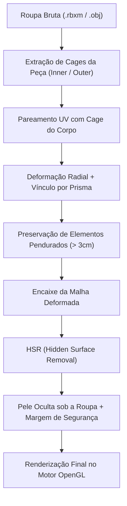
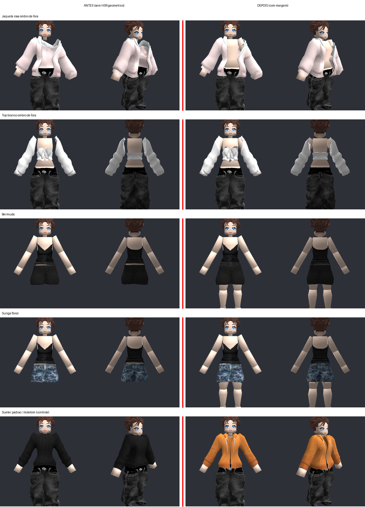
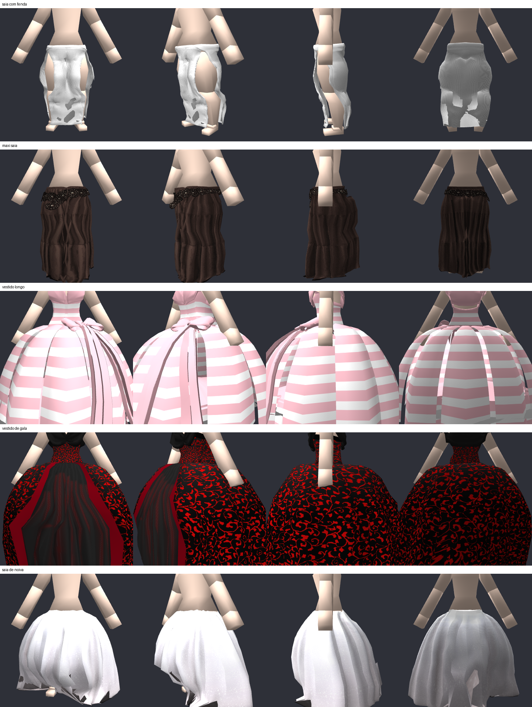
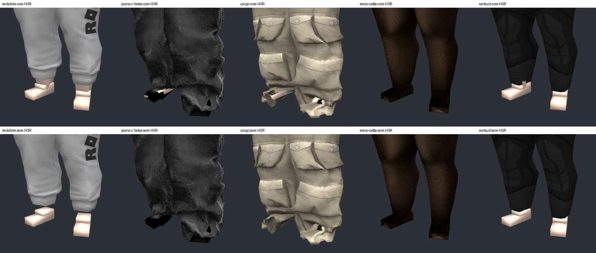

# 👗 Sistema de Roupas (WrapLayer & HSR)

## 📌 Resumo

O Isometricon possui um sistema completo e autônomo de vestuário em camadas (*layered clothing*) 100% desenvolvido em Python e integrado ao OpenGL. Inspirado na tecnologia **WrapLayer** do Roblox, o sistema substitui cortes e heurísticas manuais por uma abordagem geométrica fundamentada em **cages de referência** e **deformação radial-prismática**. O pipeline garante que qualquer roupa do catálogo Roblox vista perfeitamente os avatares do jogo (feminino e masculino) sem perfuração (*clipping*), preservando dobras, caimentos e a volumetria original do artista.

---

## 🏗️ Visão Geral da Arquitetura

O vestuário de um personagem depende do pareamento volumétrico entre pares de cages:

### Arquivos Principais do Pipeline
- `src/clothing/wrap_layer_fit.py`: Módulo orquestrador do encaixe via WrapLayer.
- `src/clothing/radial_prism_fit.py`: Núcleo matemático de projeção radial e interpolação prismática.
- `src/clothing/hsr.py`: Removedor de superfícies ocultas com suporte a máscaras binárias e geométricas.
- `src/clothing/wear_engine.py`: Motor de conformação e cache de vestuário.
- `src/clothing/character_model.py`: Representação do personagem com pilhas de roupas.

---

## 📐 Como Funciona o Pareamento por Cages

Cada peça de roupa do Roblox traz duas malhas de controle:
1. **Inner Cage (Referência R15):** Malha fechada que descreve o corpo padrão do Roblox no qual a roupa foi desenhada.
2. **Outer Cage:** Malha que envolve a superfície exterior da peça, definindo seu volume externo.

O corpo do nosso personagem possui sua própria cage de referência (`assets/models/female_cages_apose_stage2.obj` e `assets/models/male_cages_apose.obj`).

### Passos Matemáticos do Encaixe
1. **Pareamento UV:** Como nossa cage compartilha a mesma parametrização UV da cage padrão R15, cada vértice da nossa cage tem correspondência bijetiva na inner cage da roupa.
2. **Deformação Radial + Prisma:** 
   - A distância radial do vértice da roupa em relação à inner cage é medida ao longo da normal da superfície.
   - O deslocamento é mapeado para a outer cage correspondente através de coordenadas baricêntricas prismáticas.
3. **Preservação de Franjas e Pendurados:** Vértices que se encontram a mais de 3 cm da cage (como barras de saia soltas, laços, cordões) mantêm sua direção e comprimento originais em vez de serem repuxados contra as pernas ou tronco.

---

## 🛡️ HSR (Hidden Surface Removal)

Para evitar que a geometria do corpo atravesse as dobras das roupas durante poses e movimentação, o módulo `src/clothing/hsr.py` oculta dinamicamente os polígonos da pele cobertos por tecido:

1. **HSR Nativo (0x12):** Quando a roupa contém dados binários de HSR oficiais do Roblox, as faces cobertas são desativadas diretamente.
2. **Fallback Geométrico:** Para roupas que não incluem o bloco 0x12 (ou trazem versões antigas como 0x10), um algoritmo projeta raios invertidos da roupa contra a pele.
3. **Margem de Segurança:** Uma margem de pele sob as bordas abertas (golas, mangas e tornozelos) é preservada para evitar recortes visíveis ou buracos na malha.

*Figura 1: À esquerda, ausência do HSR geométrico causando furos sob roupas com decote; à direita, resultado corrigido com máscara geométrica e margem de tolerância.*

---

## 👗 Saias Longas e Término de Calças

- **Saias Longas:** Vestidos de festa e saias longas possuem ancoragem contínua para evitar rasgos entre as pernas quando o personagem se move ou altera sua pose.
- **Pés e Tornozelos:** Calças com terminação na canela ou tornozelo não ocultam inadvertidamente os pés do personagem.

*Figura 2: Saias longas, vestidos de noiva e vestidos de gala encaixados sem cortes ou distorções.*

*Figura 3: Preservação da pele dos tornozelos e pés sob diferentes modelos de calças e bermudas.*
