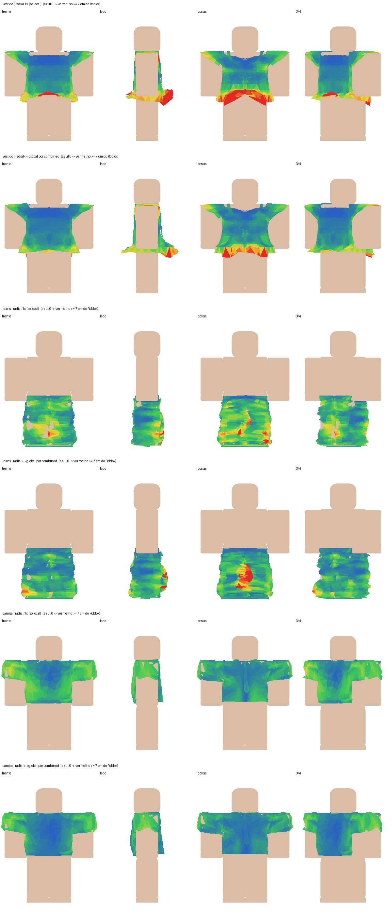
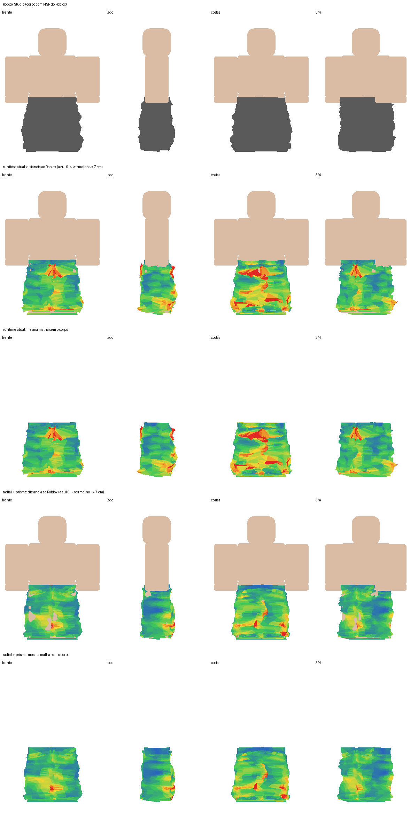
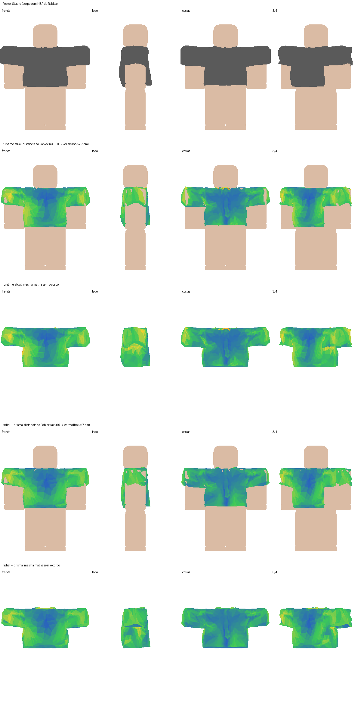
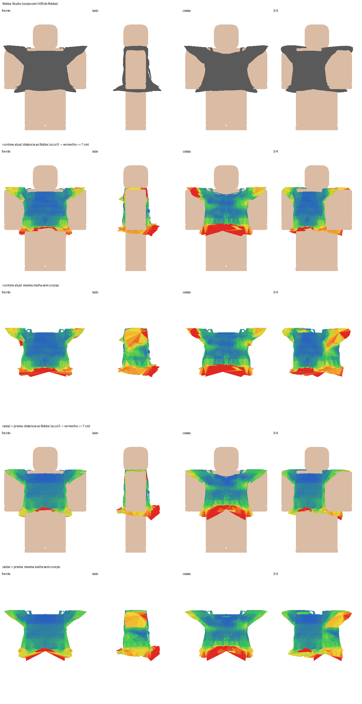
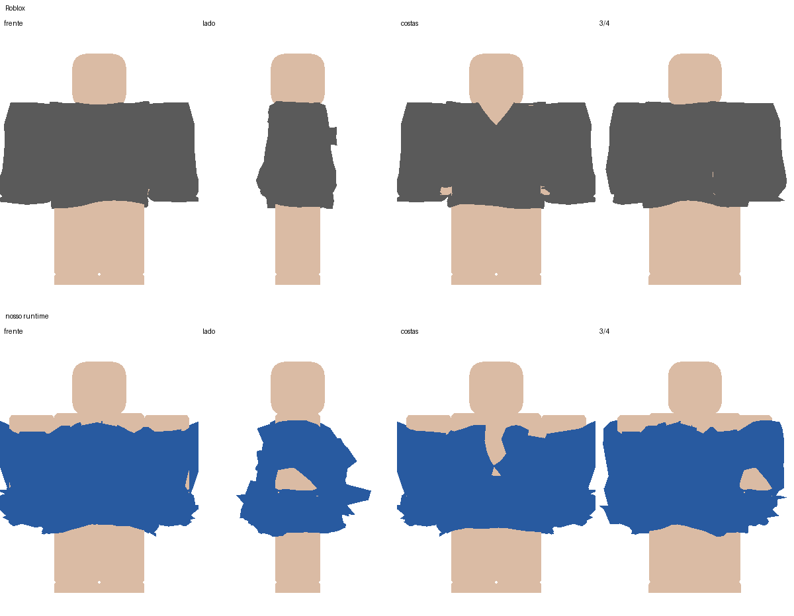
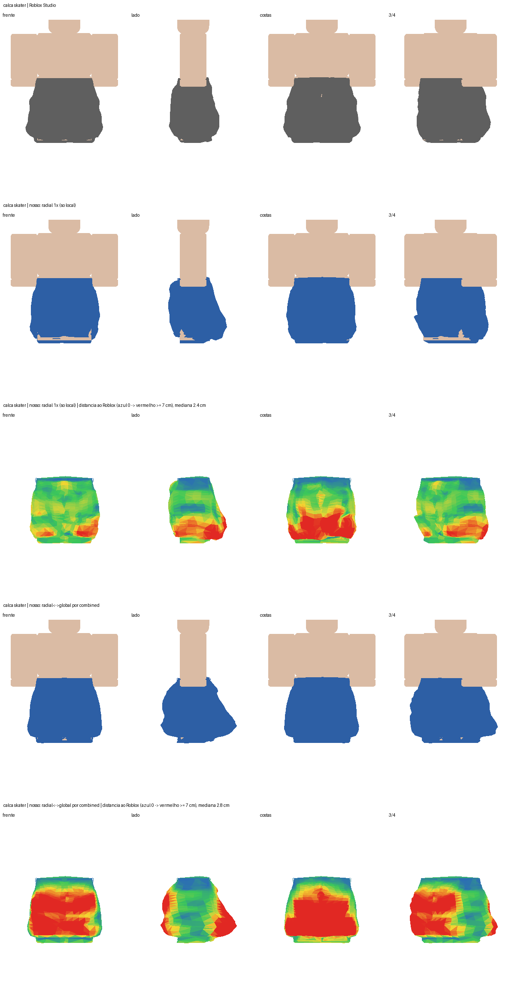
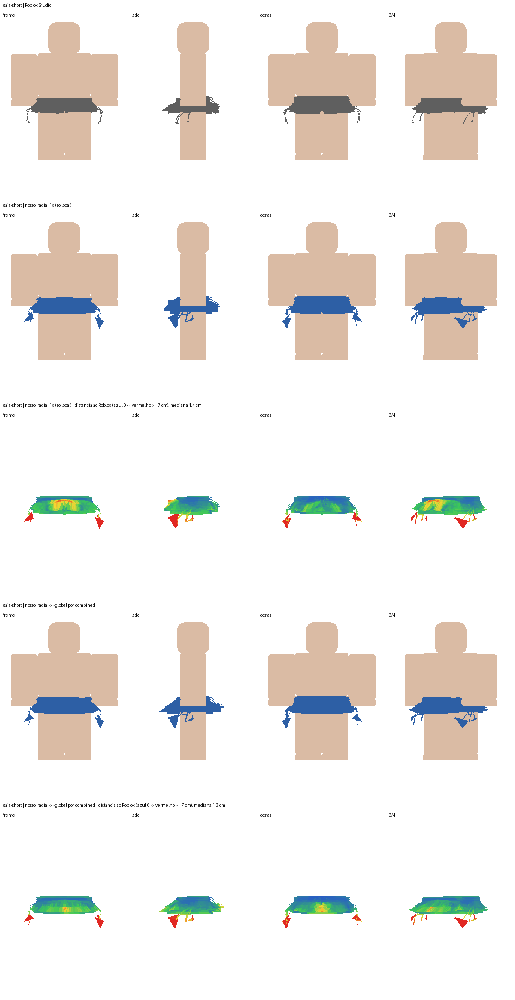
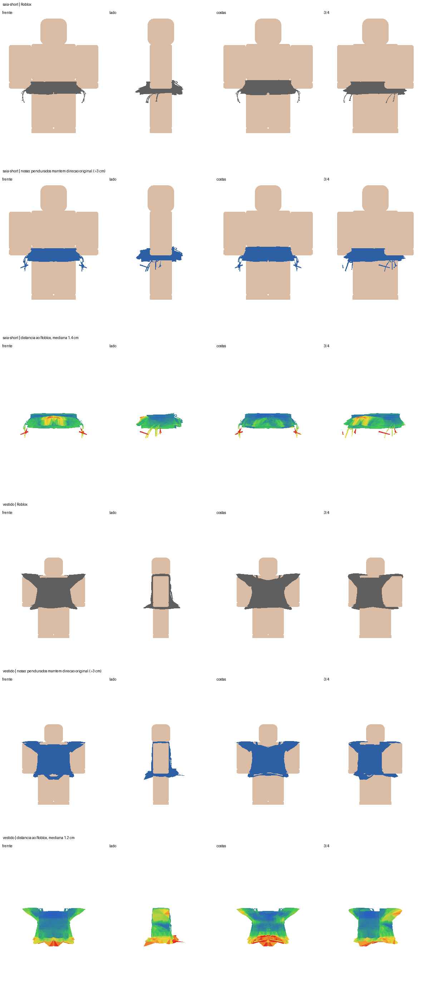

# 📊 Validação com o Roblox Studio (Ground Truth)

## 📌 Resumo

Para garantir que o motor de vestuário seja matematicamente fiel e atinja paridade visual com a tecnologia proprietária do Roblox, o Isometricon implementou um pipeline de validação automatizada contra exportações oficiais do **Roblox Studio**. As roupas foram extraídas em LOD0 diretamente do Roblox Studio e alinhadas micrometricamente (tolerância $< 10^{-4}$ studs) para medição ponto a ponto de distância euclidiana, desvios medianos, percentil 99 e preservação topológica.

---

## 🔬 Metodologia de Medição

O script `compare_roblox_ground_truth.py` (desde 10/10/2026 em `backup/scripts/`, fora do repositório, com o manequim de referência de que depende: ver [[Scripts do Projeto|Scripts-do-Projeto]]; o `batch_compare_roblox.py`, que rodava vários casos de uma vez, foi removido em 10/10/2026: dependia de módulos de experimento já apagados e não rodava mais) executa o cálculo de diferença entre a malha gerada pelo nosso runtime em Python e o modelo de referência gerado pelo motor do Roblox Studio.

### Métricas Avaliadas
- **Alinhamento de Eixos:** $< 0.0001$ studs entre origens e orientação.
- **Topologia:** Confirmação de que o número de vértices e a conectividade de triângulos permanecem idênticos aos do arquivo original.
- **Distância Euclidiana:** Mapeamento em centímetros da distância de cada vértice em relação à referência do Roblox Studio.
- **Arestas Deformadas:** Contagem de arestas com estiramento superior a $3\times$.

---

## 📈 Resultados Quantitativos dos Relatórios

Os dados abaixo são extraídos dos relatórios consolidados em `artifacts/roblox_ground_truth/batch_report.json` e `artifacts/roblox_ground_truth/catalog_robustness.json`:

| Peça Testada | ID Roblox | Topologia Idêntica | Erro Mediano (cm) | Vértices > 5cm (%) | Arestas Estiradas ($>3\times$) |
| :--- | :---: | :---: | :---: | :---: | :---: |
| **Vestido** | `114590471167431` | Sim | **1.03 cm** | **3.1%** | 38 |
| **Camisa Social** | `9240757332` | Sim | **1.22 cm** | **1.4%** | 22 |
| **Calça Jeans com Botas** | `109837605892174` | Sim | **2.26 cm** | **15.3%** | 238 |
| **Calça Skater Larga** | `133331049150205` | Sim | **2.40 cm** | **14.8%** | 194 |

> **Nota Técnica:** O resíduo nas calças ocorre porque o Roblox Studio deforma a malha com base em volumes discretizados por ossos do manequim R15 (`LowerTorso`, `LeftUpperLeg`), enquanto nosso motor aplica um campo contínuo unificado que previne descontinuidades nas juntas.

---

## 🗺️ Mapas de Calor de Erro (Heatmaps)

A escala cromática dos mapas de calor representa a distância ponto a ponto em relação ao Roblox Studio:
- **Azul:** $0\text{ cm}$ (coincidência exata com o Roblox).
- **Verde/Amarelo:** $1\text{ cm}$ a $4\text{ cm}$ (variação aceitável de folga superficial).
- **Vermelho:** $\ge 7\text{ cm}$ (diferenças acentuadas, típicas de barras livres).

### 1. Evolução do Ajuste: Radial Puro vs. Híbrido Radial + Prisma

*Figura 1: Comparativo em vestidos, calças e camisas. A formulação combinada (radial <-> global) reduziu o percentil de erro em mais de 50%.*

### 2. Calça Jeans e Camisa Social
````carousel

<!-- slide -->

<!-- slide -->

````

---

## 🔍 Detalhamento de Caimentos Específicos

### Suéter Inicial: O Problema que Motivou a Reformulação
Antes da introdução do vínculo radial prismático, deformações simplistas geravam achatamento severo da geometria:


*Figura 2: Comparação que motivou o abandono de deformações heurísticas e adoção do WrapLayer universal.*

### Elementos Pendurados e Silhueta
````carousel

<!-- slide -->

<!-- slide -->

````
